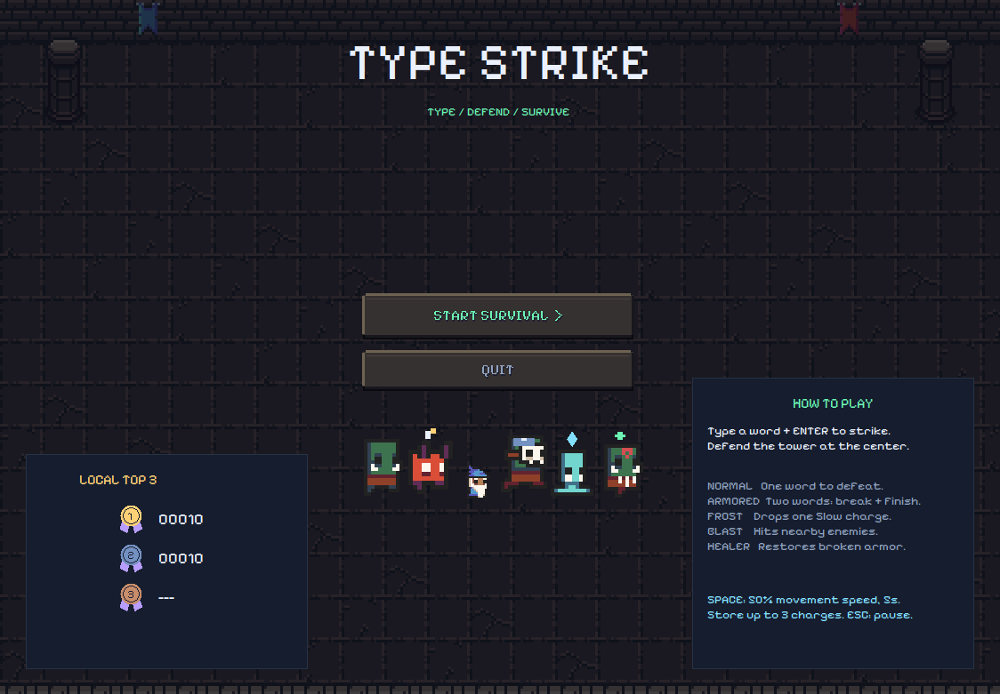
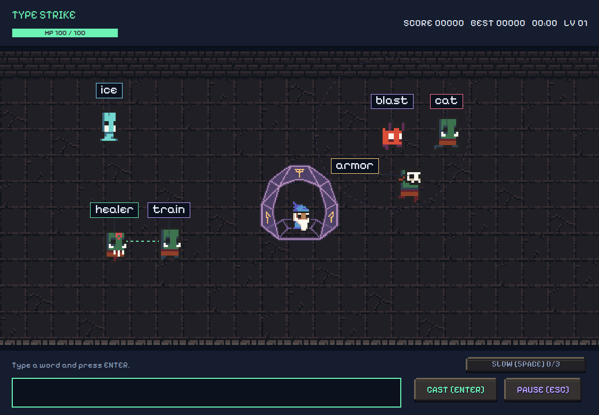
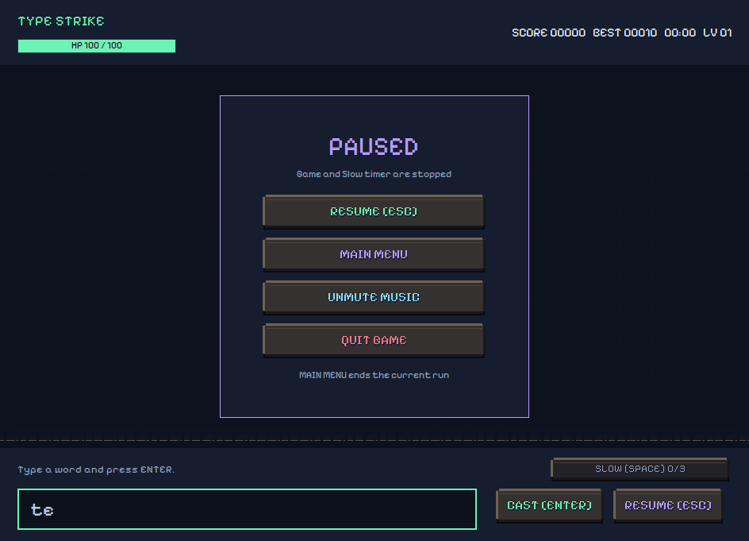

# Type Strike

เกมฝึกพิมพ์คำภาษาอังกฤษเพื่อป้องกันฐานกลางสนาม พัฒนาด้วย Java สำหรับวิชา OOP

**รุ่นปัจจุบัน v1.5.0** · [ดาวน์โหลดเกม](https://github.com/s6604062610241-hue/Type-Strike/releases/tag/v1.5.0) · [ประวัติการเปลี่ยนแปลง](CHANGELOG.md)



## วิธีเปิดเกมบน Windows

1. ติดตั้ง Java 21 ขึ้นไป หากยังไม่มีในเครื่อง
2. ดาวน์โหลด `TypeStrike-v1.5.0-Windows.zip` จากหน้าดาวน์โหลด แล้วแตกไฟล์ทั้งหมด
3. เปิด `Play.cmd` เพื่อเริ่มเล่น

ชุดดาวน์โหลดไม่ได้รวม Java ไว้ด้วย สามารถเปิดเกมผ่านคำสั่ง `java -jar TypeStrike.jar` ได้เช่นกัน

## วิธีเล่น

- พิมพ์คำเหนือศัตรูแล้วกด **Enter** หรือปุ่ม **CAST** เพื่อโจมตี ไม่ต้องคลิกเลือกศัตรู และใช้ตัวพิมพ์ใหญ่หรือเล็กก็ได้
- ป้องกันฐานที่มี **100 HP** หากศัตรูเดินถึงฐาน จะเสีย HP ตามจำนวนตัวอักษรของคำนั้น
- พิมพ์ผิดไม่เสีย HP โดยตรง แต่ศัตรูยังเดินเข้ามาเรื่อย ๆ
- คำสั้นจะเดินเร็วกว่าคำยาว และเกมจะยากขึ้นตามเวลา โดยช่วง 30 วินาทีแรกยังไม่เร่งความเร็ว
- เมื่อ HP หมด เกมจะแสดงผลและบันทึกคะแนน สามารถเล่นใหม่หรือกลับเมนูได้

### ศัตรูทั้ง 5 ประเภท

| ประเภท | ความสามารถ | คะแนนเมื่อกำจัด |
| --- | --- | --- |
| Normal — Orc Warrior | พิมพ์คำเดียวเพื่อกำจัด | 10 |
| Armored — Masked Orc | คำแรกทำลายเกราะและเปลี่ยนคำ พิมพ์คำใหม่อีกครั้งเพื่อกำจัด | 25 |
| Frost — Ice Zombie | เมื่อกำจัด จะได้รับพลัง Slow 1 ครั้ง | 20 |
| Blast — Imp | เมื่อกำจัด จะระเบิดใส่ศัตรูใกล้เคียง ทำลายเกราะหรือกำจัดศัตรู และระเบิดต่อกันได้ | 15 |
| Healer — Orc Shaman | คืนเกราะให้ Armored ที่อยู่ใกล้ทุก 8 วินาที มีสัญญาณเตือนก่อนรักษา และมีได้ครั้งละ 1 ตัว | 20 |

ศัตรูพิเศษจะทยอยปรากฏระหว่างเล่น เมื่อเกราะแตก Masked Orc จะเปลี่ยนเป็น Orc Warrior และกลับเป็น Masked Orc เมื่อได้รับเกราะคืนจาก Healer โดยยังใช้คำเดิมตอนคืนเกราะ

ระเบิดของ Blast ไม่ทำร้ายฐาน หากระเบิดกำจัด Frost ก็ยังได้รับพลัง Slow แต่ถ้า Blast เดินถึงฐานจะสร้างความเสียหายตามปกติโดยไม่ระเบิด

### พลัง Slow และการพักเกม

- กด **Space** หรือปุ่ม **SLOW** เพื่อใช้พลัง ลดความเร็วศัตรูลงครึ่งหนึ่งนาน **5 วินาที**
- เก็บพลังได้สูงสุด **3 ครั้ง** และใช้ซ้อนระหว่างที่พลังยังทำงานไม่ได้
- Slow ลดเฉพาะความเร็วเดิน ศัตรูยังเกิดและ Healer ยังรักษาตามเวลาเดิม
- กด **Escape** หรือปุ่ม **PAUSE** เพื่อพักเกม เล่นต่อ กลับเมนู ปิดเพลง ปิดเสียงเอฟเฟกต์ หรือออกจากเกม
- เกมพักอัตโนมัติเมื่อสลับไปหน้าต่างอื่น การกลับเมนูระหว่างเล่นจะจบรอบนั้นโดยไม่บันทึกคะแนน



## ภาพและเสียง

เกมใช้ภาพพิกเซลในธีมดันเจียน พร้อมบาเรียโดมรอบพ่อมดและมงกุฎสำหรับคะแนนสามอันดับ ตัวอักษรใช้ **Pixelify Sans** ซึ่งรวมอยู่ในเกมแล้ว

เพลงเมนูคือ **The Old Magician** และเพลงระหว่างเล่นคือ **Battle Theme I loop** โดย HydroGene ส่วนเสียงเอฟเฟกต์จาก Kenney ใช้กับการกำจัดศัตรู เกราะแตก ฐานถูกโจมตี พลัง Slow และระเบิด Blast

ปิดเพลงและเสียงเอฟเฟกต์แยกกันได้ในหน้าพักเกม โดยเกมจะจำตัวเลือกไว้จนปิดโปรแกรม

เครดิตและใบอนุญาตของไฟล์ที่ใช้:

- [ภาพตัวละครและฉาก — 0x72 DungeonTileset II](resources/art/0x72/CREDITS.txt)
- [ภาพโดมและมงกุฎ — สร้างด้วย ImageGen ตามแบบที่เลือก](resources/art/custom/CREDITS.txt)
- [เพลง — HydroGene](resources/audio/CREDITS.txt)
- [เสียงเอฟเฟกต์ — Kenney](resources/audio/sfx/CREDITS.txt)
- [ฟอนต์ — Pixelify Sans](resources/fonts/OFL.txt)



## คะแนนและคำศัพท์

เกมบันทึกคะแนนสูงสุดสามอันดับไว้ในเครื่องที่ `%USERPROFILE%\.type-strike\scores.txt` แต่ละเครื่องมีตารางคะแนนของตนเอง ไม่ใช่ตารางออนไลน์

**Match Rate** คือสัดส่วนคำที่พิมพ์ส่งแล้วตรงกับศัตรู เทียบกับคำที่ส่งทั้งหมด รวมการทำลายเกราะด้วย

คลังคำมี **620 คำ** ใน `resources/words.txt` สามารถเพิ่มคำภาษาอังกฤษตัวพิมพ์เล็ก ความยาว 3–10 ตัวอักษร โดยใส่หนึ่งคำต่อบรรทัด แล้วสร้างเกมใหม่เพื่อใช้คลังคำที่แก้ไข เกมยังไม่มีคำแปล

## สำหรับผู้ที่ต้องการแก้ไขโค้ด

ใช้ **JDK 21 ขึ้นไป** เปิด `Build.cmd` เพื่อสร้างไฟล์ `dist/TypeStrike.jar` แล้วเปิด `Play.cmd` เพื่อเล่น

หากใช้ VS Code ให้ติดตั้ง **Extension Pack for Java** แล้วเปิด `src/typestrike/Main.java` และกด Run เหนือ `main()` เกมใช้ Java Swing และไม่ต้องติดตั้งเอนจินเกมเพิ่มเติม

สร้างเกมและรันชุดทดสอบผ่าน PowerShell ได้ด้วยคำสั่ง:

```powershell
powershell -NoProfile -ExecutionPolicy Bypass -File .\build.ps1
powershell -NoProfile -ExecutionPolicy Bypass -File .\test.ps1
java -jar .\dist\TypeStrike.jar
```

ชุดทดสอบครอบคลุมกติกา คะแนน พลัง Slow ศัตรูพิเศษ และการโหลดภาพกับเสียง

### โฟลเดอร์หลัก

| โฟลเดอร์ | ใช้เก็บอะไร |
| --- | --- |
| `src/typestrike/` | โค้ดเกม แบ่งเป็นกติกา หน้าจอ เสียง และการบันทึกคะแนน |
| `resources/` | คำศัพท์ ภาพ ฟอนต์ เสียง และเครดิต |
| `tests/` | โค้ดทดสอบเกม |
| `screenshots/` | ภาพหน้าจอรุ่นปัจจุบัน |
| `tools/` | เครื่องมือจัดชุดไฟล์สำหรับเผยแพร่ |
| `artifacts/` | ชุดไฟล์รุ่นเก่า v1.0.0–v1.1.2 |

ดูสิ่งที่เปลี่ยนในแต่ละรุ่นได้ที่ [ประวัติการเปลี่ยนแปลง](CHANGELOG.md) และดาวน์โหลดรุ่นตั้งแต่ v1.2.0 ได้ที่ [GitHub Releases](https://github.com/s6604062610241-hue/Type-Strike/releases)
