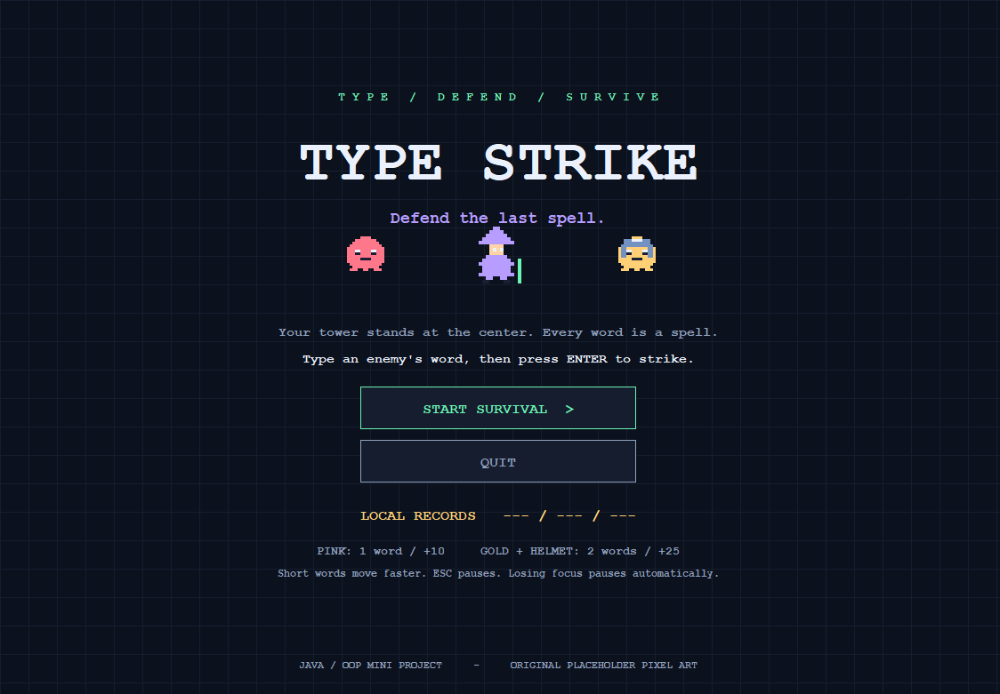
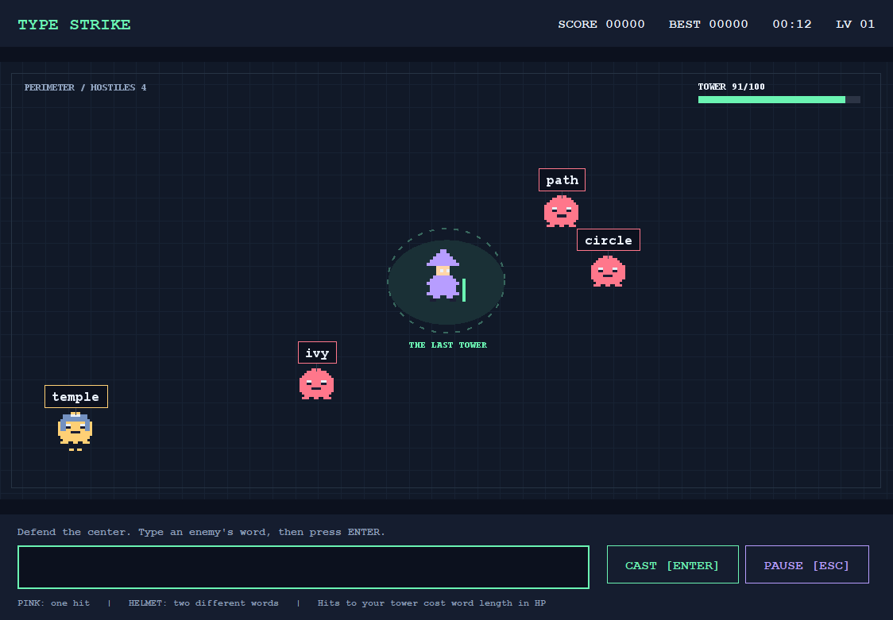
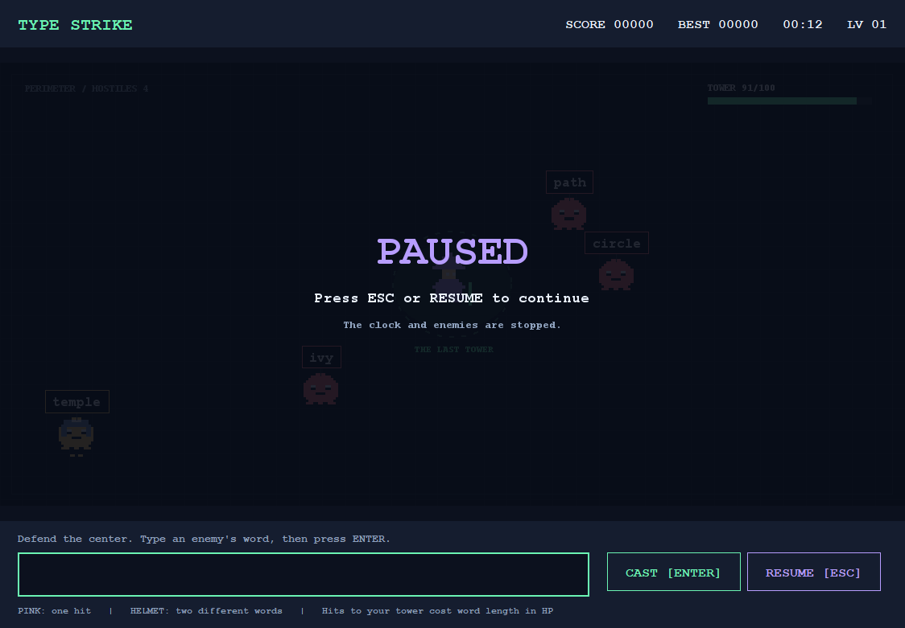
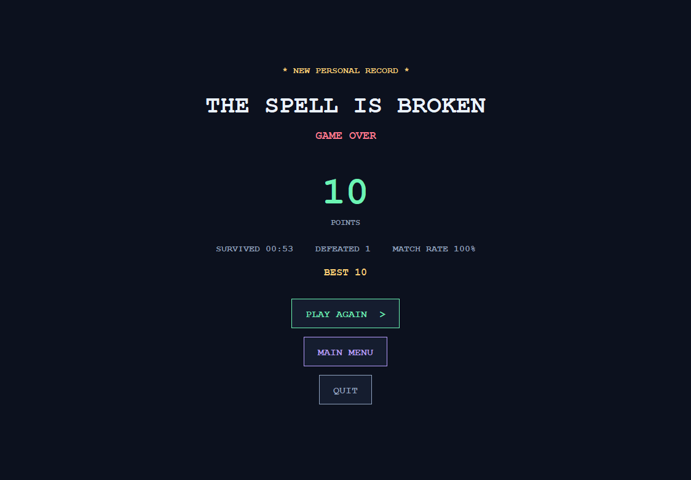
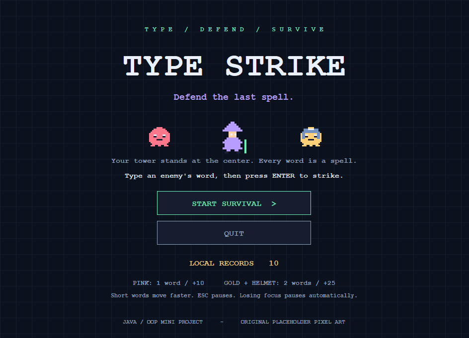

# Type Strike v1.0.0

เวอร์ชันแรกของเกม ฐานกลางสนาม ศัตรูปกติและเกราะ การพิมพ์โจมตี Pause, Game Over และคะแนนสูงสุดสามอันดับ

## ดาวน์โหลด

- [Source Code แบบ ZIP](TypeStrike-v1.0.0-Source.zip)
- [ชุดเล่นบน Notebook Windows](TypeStrike-v1.0.0-Windows.zip) แตกไฟล์แล้วเปิด Play.cmd ต้องมี Java 21 ขึ้นไป
- [Executable JAR](TypeStrike-v1.0.0.jar)
- [สำเนาครบชุดของเวอร์ชันแรก](TypeStrike-v1.0.0-full-backup.zip) รวม Source, ZIP, JAR, คู่มือ, แนวทางนำเสนอ, รายงานเดิม และภาพหน้าจอ
- [SHA256 ของ ZIP สำรอง](TypeStrike-v1.0.0-full-backup.zip.sha256)

หาก GitHub ไม่เปิดตัวอย่างไฟล์ ZIP ให้เลือก Download raw file หรือปุ่ม Download เพื่อดาวน์โหลดไฟล์จริง

## คู่มือและเอกสาร

- [OOP concepts](../../docs/OOP-GUIDE.md)
- [กติกาเกม](../../docs/GAME-DESIGN.md)
- [แนวทางนำเสนอ](../../docs/PRESENTATION.md) เป็นเอกสารข้อความ ไม่ใช่สไลด์ PowerPoint
- [รายงาน PDF เดิม](../../docs/TypeStrike-Report-TH.pdf)
- [ต้นฉบับรายงาน Markdown](../../docs/TypeStrike-Report-TH.md)
- [ต้นฉบับรายงาน HTML](../../docs/TypeStrike-Report-TH.html)

รายงานเก็บเป็นเอกสารประกอบเวอร์ชันแรก ผู้จัดทำจะเขียนต่อด้วยตนเอง การพัฒนาถัดไปเน้นตัวเกม

## ภาพหน้าจอของเวอร์ชันแรก

ชุดไฟล์ในโฟลเดอร์นี้เป็นสำเนาของ v1.0.0 ที่เก็บไว้ในเครื่อง ไม่เขียนทับเมื่อทำเวอร์ชันใหม่ ประวัติ Source Code เก็บด้วย Git commits การเผยแพร่นี้ไม่เปลี่ยนกติกาเกมและไม่แก้เนื้อหารายงาน
