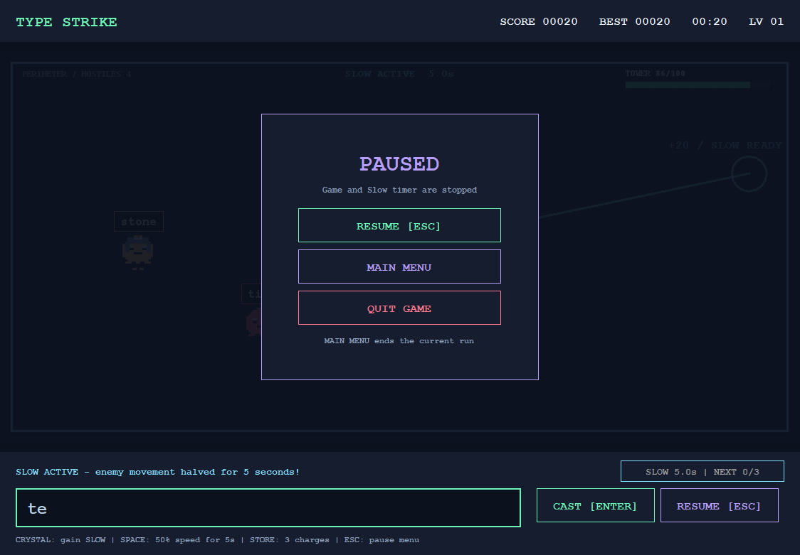
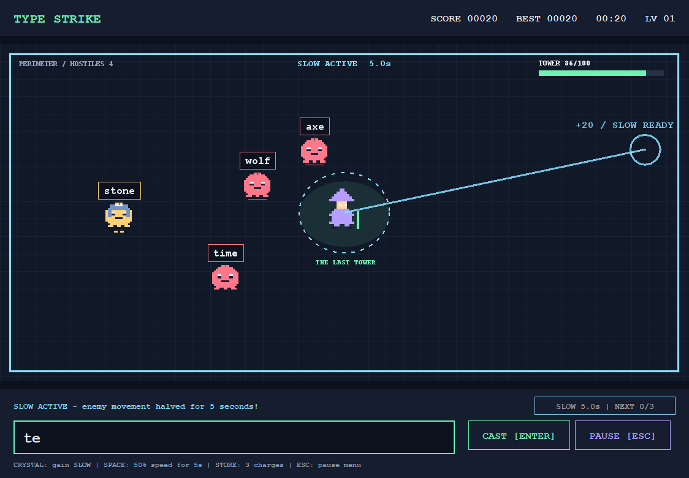

# Type Strike v1.1.1

รุ่นปรับสมดุลตามความคิดเห็นหลังทดลอง v1.1.0

- เริ่มเคลื่อนที่ช้าลง 15% ช่วง 30 วินาทีแรกไม่เร่งความเร็ว จากนั้นเพิ่มช้าลงและจำกัดเพดานที่ +50%
- ศัตรูเกิดห่างขึ้น เริ่มประมาณทุก 2.8 วินาทีและค่อยลดลงจนต่ำสุด 1.2 วินาที Level เพิ่มทุกหนึ่งนาที
- Slow ทำงาน **5 วินาที** เก็บได้ **3 ชาร์จ** ใช้ครั้งละหนึ่งชาร์จ กด Space โดยไม่ลบคำพิมพ์ ใช้เอฟเฟกต์ซ้อนไม่ได้
- Frost ยังคงสัดส่วนสุ่ม 16% และมีตัวแรกเป็นศัตรูตัวที่ 8 ชาร์จเต็มแล้วยังได้คะแนนจากการกำจัด
- Pause มี **Resume / Main Menu / Quit Game** กลับเมนูจะจบรอบปัจจุบัน เริ่มใหม่จะรีเซ็ตคะแนน HP เวลาและพลัง
- นำเมนูเลือกธีมและ F1/F2/F3 ออกจากรุ่นเล่นจริง ใช้ชุดสีเดิม v1.0.0 ไว้ก่อน เวอร์ชันเก่ายังอยู่ในประวัติ
- ไม่มีการเพิ่มเสียงหรือแก้รายงานในรุ่นนี้

## ดาวน์โหลด

- [Source ZIP](TypeStrike-v1.1.1-Source.zip)
- [Windows / Notebook ZIP](TypeStrike-v1.1.1-Windows.zip) แตกไฟล์แล้วเปิด Play.cmd ต้องมี Java 21 ขึ้นไป
- [Executable JAR](TypeStrike-v1.1.1.jar)
- [SHA256SUMS](SHA256SUMS.txt)

## ภาพตัวอย่าง

ตรวจการเก็บครบสามชาร์จและใช้ต่อกันหลังเอฟเฟกต์หมด, ระยะเวลา 5 วินาที, จังหวะนาทีแรก, Pause/Resume, กลับเมนูและเริ่มรอบใหม่, Quit และขนาดหน้าต่างต่ำสุดแล้ว ยังต้องปรับจากการเล่นจริงต่อ
