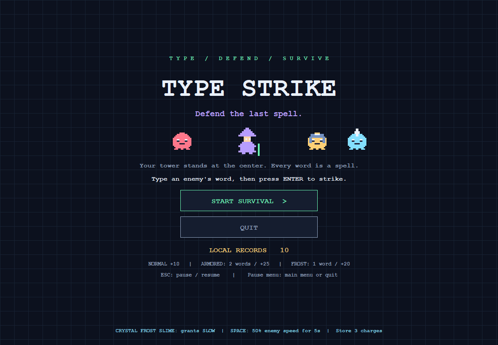
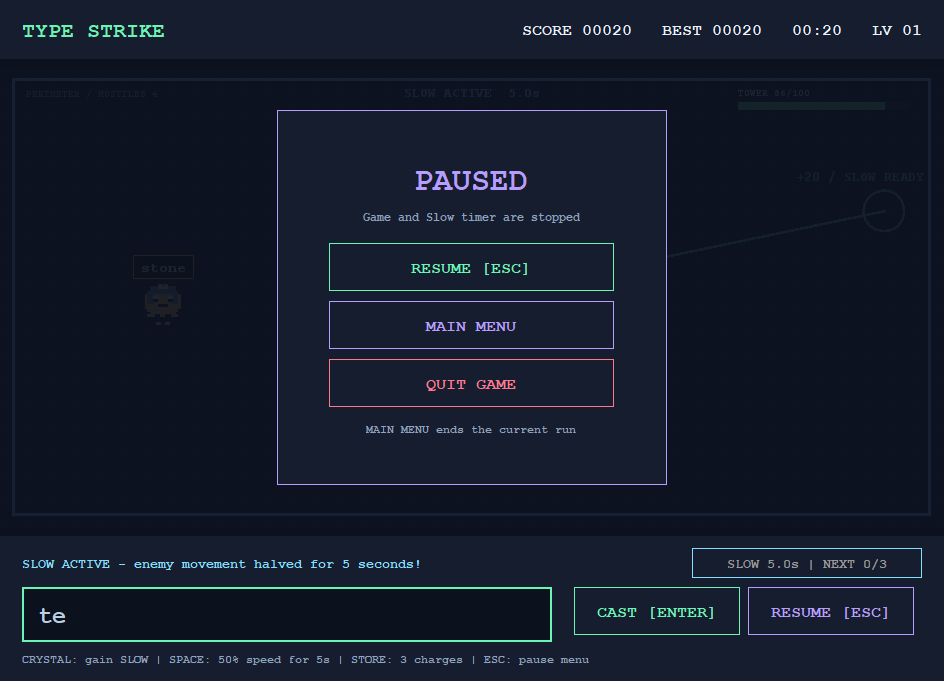

# Type Strike v1.1.1

Gentler difficulty, five-second Slow, three charges and a full pause menu.

- [Source ZIP](TypeStrike-v1.1.1-Source.zip)
- [Windows / Notebook ZIP](TypeStrike-v1.1.1-Windows.zip)
- [Executable JAR](TypeStrike-v1.1.1.jar)
- [SHA256SUMS](SHA256SUMS.txt)

Requires Java 21 or newer. Extract the Windows ZIP and open Play.cmd.
Source: src/ in the repository or the Source ZIP. Build with Build.cmd.

