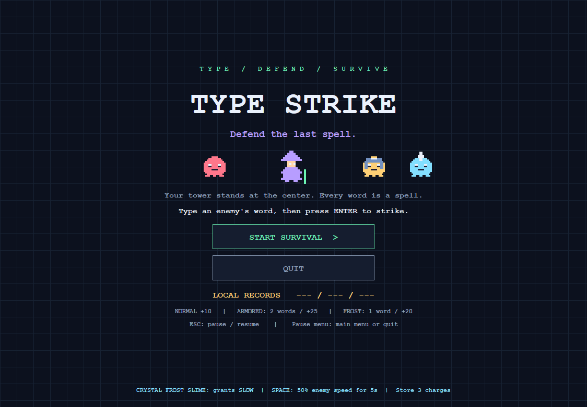
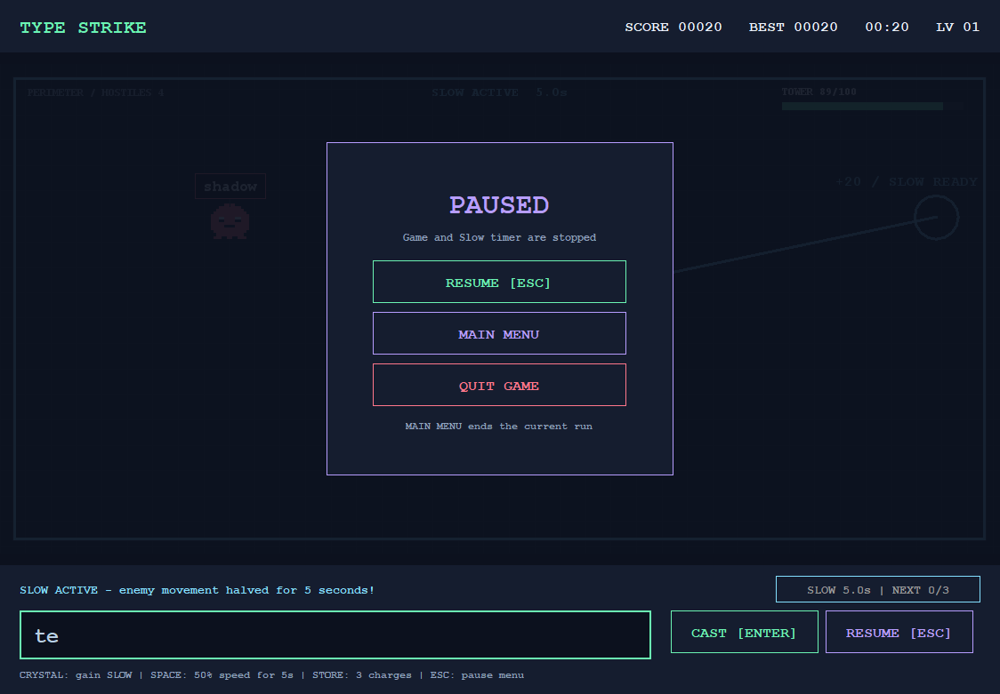
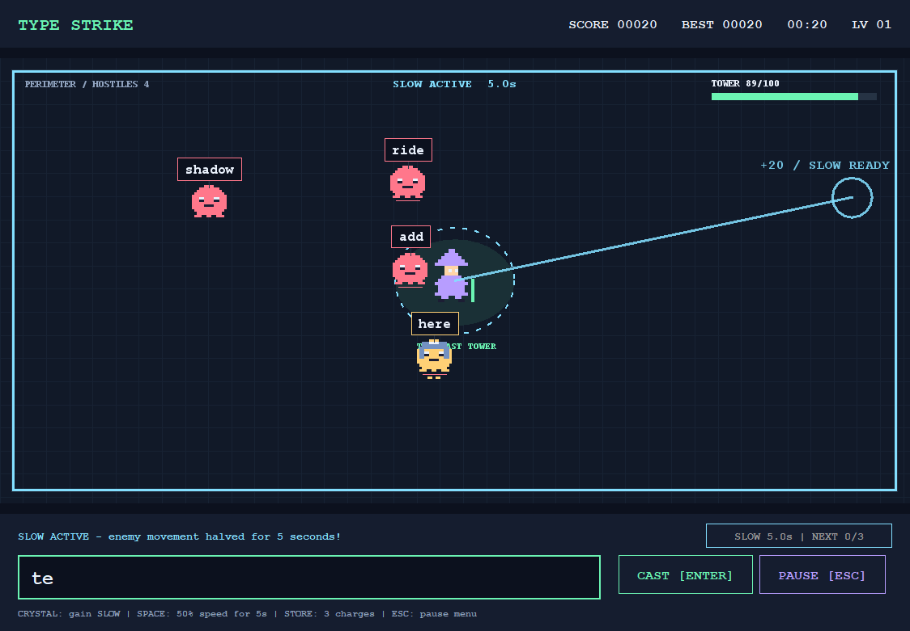

# Type Strike v1.1.2

Same gameplay as v1.1.1, with more everyday vocabulary and game-only public packages.

- [Source ZIP](TypeStrike-v1.1.2-Source.zip)
- [Windows / Notebook ZIP](TypeStrike-v1.1.2-Windows.zip)
- [Executable JAR](TypeStrike-v1.1.2.jar)
- [SHA256SUMS](SHA256SUMS.txt)

Requires Java 21 or newer. Extract the Windows ZIP and open Play.cmd.
Source: src/ in the repository or the Source ZIP. Build with Build.cmd.

