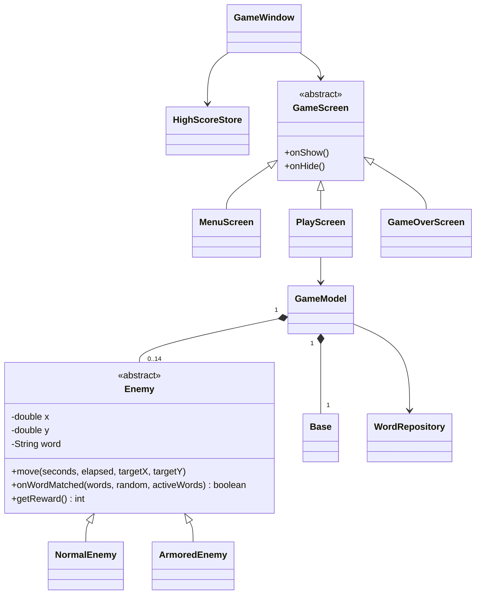

# OOP ใน Type Strike

คำอธิบายนี้อ้างอิงโค้ดในโปรเจกต์ ใช้ประกอบรายงานและเตรียมนำเสนอ ควรเปิดโค้ดจริงพร้อมอธิบายว่าแต่ละส่วนแก้ปัญหาใด

## Constructor

`Enemy(long id, String word, double x, double y)` กำหนดข้อมูลเริ่มต้นของศัตรู ลูกคลาสเรียก `super(...)` เพื่อตั้งค่าเดียวกัน `GameModel(WordRepository words, Random random)` รับสิ่งที่ต้องใช้ผ่าน Constructor เพื่อให้ทดสอบด้วยเลขสุ่มที่กำหนดได้

## Encapsulation

`Base.health` เป็น private ไม่มี public setter ส่วนอื่นเรียก `takeDamage()` ซึ่งป้องกันค่าติดลบและจำกัด HP ไม่ให้ต่ำกว่า 0 `Enemy` ซ่อนพิกัดและคำศัพท์ มีเมธอดอ่านค่าและควบคุมการเคลื่อนที่ `GameModel.getEnemies()` คืนรายการที่เพิ่มหรือลบสมาชิกจากภายนอกไม่ได้ อย่างไรก็ตามสมาชิก Enemy ยังคงเป็น Object เดิม ไม่ใช่สำเนาที่แก้ไขไม่ได้ทั้งหมด

## Composition

`GameModel` สร้างและเป็นเจ้าของ `Base` และ `List<Enemy>` หนึ่งรอบใหม่ใช้ `GameModel` ใหม่ จึงได้ฐานและกลุ่มศัตรูใหม่ `PlayScreen` ประกอบด้วย Arena, JTextField, JLabel, JButton และ Timer ซึ่งแต่ละองค์ประกอบมีหน้าที่เฉพาะ

## Abstract

`Enemy` เป็น abstract class จึงสร้าง `new Enemy(...)` โดยตรงไม่ได้ กำหนดสัญญา `onWordMatched()`, `getReward()` และ `getKind()` ให้ลูกคลาสทำเอง แต่ใช้การเคลื่อนที่ร่วมกันได้ อีกตัวอย่างคือ `GameScreen` ซึ่งกำหนด `onShow()` เป็น abstract method

## Inheritance

`NormalEnemy extends Enemy` และ `ArmoredEnemy extends Enemy` ใช้ข้อมูลและเมธอดที่คลาสแม่เตรียมไว้ `MenuScreen`, `PlayScreen` และ `GameOverScreen` สืบทอดจาก `GameScreen` และสุดท้ายเป็น Swing JPanel

## Polymorphism

ใน `GameModel.submit()` ตัวแปรชนิด `Enemy` เรียก `enemy.onWordMatched(...)` โดยไม่ต้องเขียน if ตรวจชนิดก่อนโจมตี ถ้าเป็น NormalEnemy จะคืน true ทันที ถ้าเป็น ArmoredEnemy ที่ยังมีเกราะจะเปลี่ยนคำและคืน false Java เลือกเมธอดตามชนิด Object ขณะทำงาน

```java
boolean eliminated = enemy.onWordMatched(words, random, activeWords());
int reward = eliminated ? enemy.getReward() : 0;
```

UI ใช้ `hasArmor()` และ `getKind()` เพื่อเลือกภาพและสี ส่วนกติกาการโจมตีและคะแนนใช้เมธอดที่ Override ไม่ผูกกับการวาดภาพ

## GUI และ Event Handling

- `GameWindow` ใช้ JFrame และ CardLayout เพื่อเปลี่ยนหน้าจอ
- `PlayScreen` ใช้ BorderLayout แบ่ง Header, Arena และ Input ส่วนล่าง
- `JTextField.addActionListener()` รับ Enter ส่วน `JButton.addActionListener()` รับการกดปุ่ม
- `InputMap` และ `ActionMap` รับ Escape แม้ Focus อยู่ที่ช่องพิมพ์
- `WindowFocusListener` หยุดเกมเมื่อหน้าต่างเสีย Focus
- `javax.swing.Timer` เรียก tick ประมาณทุก 16 มิลลิวินาที และประมวลผลบน Event Dispatch Thread เดียวกับ Input
- `Arena.paintComponent()` วาดสนาม ฐาน ศัตรู คำศัพท์ และเอฟเฟกต์ ไม่ใช้เมธอดนี้คำนวณการเคลื่อนที่

## แผนภาพคลาส



## ลำดับการทำงานของหนึ่งเฟรม

Timer → `PlayScreen.tick()` → `GameModel.update(seconds)` → ขยับศัตรู → ตรวจถึงฐาน → ลด HP / ลบศัตรู → ตรวจเวลาเกิด → สร้างศัตรู → อัปเดต HUD → repaint → หาก HP หมด บันทึกคะแนนและไปหน้า Game Over

## เหตุผลที่แยก Model ออกจาก GUI

กติกาเกมไม่ต้องสร้างหน้าต่าง Swing จึงทดสอบการโจมตี การหยุดเวลา และการจบเกมแบบอัตโนมัติได้ การเปลี่ยนสี ปุ่ม หรือรูปไม่ควรเปลี่ยนกติกา อีกทั้งอาจารย์สามารถดูแนวคิด OOP ใน Model โดยไม่ต้องอ่านโค้ดวาดภาพทั้งหมด
