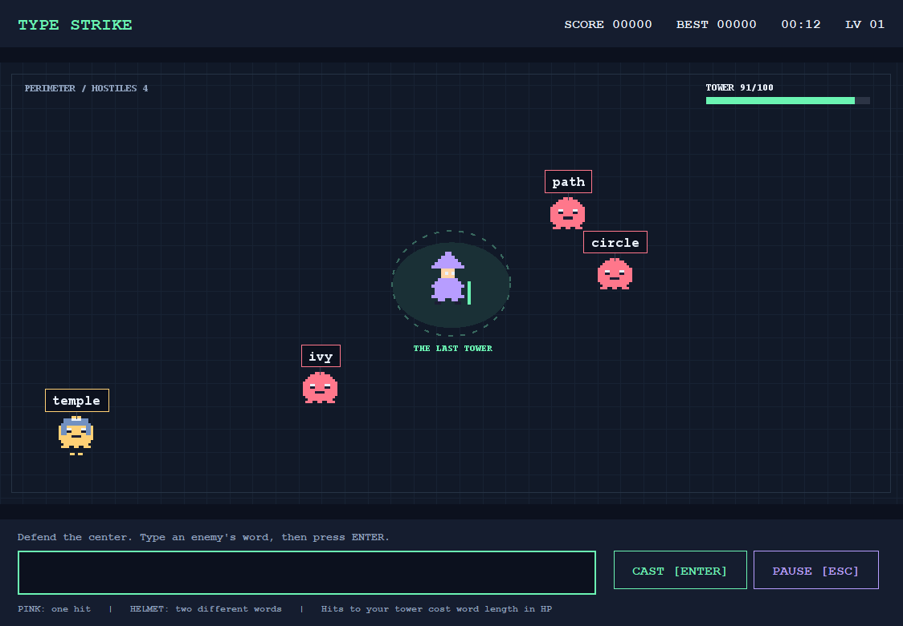

# รายงานโครงงานเกม Type Strike

พิมพ์ปะทะศัตรู

รายวิชาการเขียนโปรแกรมเชิงวัตถุ  |  กำหนดนำเสนอ 4 พฤศจิกายน 2026

### ภาพรวมโครงงาน

Type Strike เป็นเกมพิมพ์คำศัพท์ภาษาอังกฤษแบบ Endless ผู้เล่นป้องกันฐานที่อยู่กลางสนามจากศัตรูที่เข้ามาจากขอบจอ โดยพิมพ์คำเหนือศัตรูแล้วกด Enter การเลือกคำขึ้นอยู่กับระยะห่าง ความเร็ว และเกราะของศัตรู เกมจบเมื่อพลังชีวิตฐานหมด

โครงงานพัฒนาด้วย Java 21 และ Swing ในรูปแบบ Desktop Application แยกกติกาเกมออกจาก GUI และระบบบันทึกคะแนน เพื่อให้เห็นการประยุกต์ใช้ Constructor, Encapsulation, Composition, Polymorphism, Abstract และ Inheritance ในส่วนที่ทำงานจริง

### เนื้อหาในรายงาน

| ส่วน | เนื้อหา |
| --- | --- |
| บทที่ 1 | ที่มา ประเภทโครงการ วัตถุประสงค์ ประโยชน์ และขอบเขต |
| บทที่ 2 | วิธีเล่น GUI คลาส แนวคิด OOP Event Handling อัลกอริทึม และการทดสอบ |
| บทที่ 3 | ผลการพัฒนา ปัญหา ข้อจำกัด จุดเด่น และแนวทางพัฒนาต่อ |
| ภาคผนวก | วิธี Build และ Run รายการส่งมอบ และแหล่งข้อมูล |

### ผลลัพธ์ของเวอร์ชันแรก

มีหน้า Menu, Gameplay และ Game Over ศัตรูสองชนิด ระบบหยุดเกม คะแนนสูงสุดสามอันดับ และไฟล์ JAR ที่รวมคลังคำศัพท์ การทดสอบกติกาอัตโนมัติผ่านแล้ว ส่วนความยากและการใช้งานบน Notebook เครื่องนำเสนอยังต้องตรวจจากการเล่นจริง

## บทที่ 1 บทนำ

### 1 1 ที่มาและความสำคัญ

การพิมพ์ภาษาอังกฤษต้องอาศัยความเร็วและความแม่นยำ การฝึกผ่านเกมช่วยให้ผู้เล่นเห็นผลจากการตัดสินใจและการพิมพ์ทันที Type Strike ใช้การโจมตีด้วยคำศัพท์แทนการเล็งด้วยเมาส์ และเพิ่มแรงกดดันด้วยศัตรูที่เคลื่อนเข้าหาฐานอย่างต่อเนื่อง

ฐานกลางสนามทำให้ผู้เล่นต้องสังเกตหลายทิศทาง ขณะที่ศัตรูเกราะต้องใช้สองคำ จึงเกิดการจัดลำดับเป้าหมาย โครงงานใช้ปัญหานี้เป็นบริบทสำหรับออกแบบคลาสและแสดงความแตกต่างของพฤติกรรมระหว่างวัตถุ

### 1 2 ประเภทและวัตถุประสงค์

เป็นโครงงานซอฟต์แวร์เกม 2 มิติแนว Typing Defense แบบ Endless ในรูปแบบ Java Desktop Application มีวัตถุประสงค์เพื่อสร้างเกมที่เล่นได้ แสดงแนวคิด OOP ด้วยโค้ดจริง และจัดทำโปรแกรมพร้อมเอกสารที่นำไป Build และทดสอบบนอีกเครื่องได้

### 1 3 ประโยชน์ที่คาดว่าจะได้รับ

ผู้เล่นได้ฝึกการอ่านและพิมพ์คำศัพท์ รวมถึงเลือกจัดการเป้าหมายภายใต้เวลาจำกัด ส่วนผู้พัฒนาได้ฝึกแยกความรับผิดชอบของคลาส ออกแบบ GUI รับ Event และตรวจสอบกติกาด้วยการทดสอบอัตโนมัติ ประโยชน์ด้านทักษะของผู้เล่นเป็นเป้าหมายของโครงงาน ยังไม่ได้วัดผลด้วยการทดลองเชิงสถิติ

### 1 4 ขอบเขตโครงงาน

เกมมีฐานหนึ่งจุด ศัตรูปกติและศัตรูเกราะ คำศัพท์ภาษาอังกฤษ การส่งคำด้วย Enter แถบ HP คะแนน เวลา Level และสถิติสูงสุดสามอันดับ ความยากเพิ่มตามเวลาแต่จำกัดความเร็วและจำนวนศัตรู ผู้เล่นเริ่มรอบใหม่หรือออกจากเกมได้

เวอร์ชันนี้ใช้ภาพ Pixel Art ชั่วคราวที่วาดด้วยโค้ด ไม่ใช้ Asset ของตัวอย่างรุ่นพี่ ไม่มีระบบออนไลน์ บัญชีผู้เล่น ดนตรี หรือระบบ WPM เกมใช้ Java Standard Library และต้องมี Java 21 หรือใหม่กว่าบนเครื่องปลายทาง

## บทที่ 2 การพัฒนาเกม

### 2 1 เนื้อเรื่องและวิธีเล่น

ผู้เล่นเป็นผู้พิทักษ์ฐานเวทมนตร์กลางสนาม ศัตรูเดินมาจากขอบจอโดยมีคำภาษาอังกฤษเหนือหัว พิมพ์คำแล้วกด Enter หรือ CAST เพื่อโจมตี ไม่ต้องคลิกเลือกศัตรู คำไม่แยกตัวพิมพ์ใหญ่เล็กและตัดช่องว่างหัวท้าย คำที่กำลังพิมพ์ตรงกับต้นคำของศัตรูจะแสดงสีเขียว

| องค์ประกอบ | กติกา |
| --- | --- |
| ฐาน | เริ่ม 100 HP ศัตรูถึงฐานหัก HP ตามจำนวนตัวอักษรของคำปัจจุบัน |
| ศัตรูปกติ | พิมพ์ถูกหนึ่งครั้งเพื่อกำจัด ได้ 10 คะแนน |
| ศัตรูเกราะ | คำแรกทำลายเกราะและเปลี่ยนคำ คำที่สองกำจัด ได้ 25 คะแนน |
| พิมพ์ผิด | ไม่หัก HP ทันที แต่ศัตรูยังเคลื่อนต่อ |
| Pause | กด Escape หรือปุ่ม PAUSE เวลาจำลองและศัตรูหยุด |
| การจบเกม | HP หมดจึง Game Over แสดงคะแนน เวลา จำนวนที่กำจัด และ Match Rate |

### 2 2 หน้าจอและองค์ประกอบ GUI

GameWindow ใช้ JFrame เป็นหน้าต่างหลักและ CardLayout สลับสามหน้าจอ Menu มีปุ่ม Start และ Quit พร้อมสถิติ Gameplay ใช้ BorderLayout แบ่ง Header, Arena และช่องพิมพ์ด้านล่าง Game Over มีปุ่มเล่นใหม่ เมนู และออกจากเกม

JLabel แสดงข้อความและ HUD, JTextField รับคำ, JButton รับการกดปุ่ม และ JPanel เป็นพื้นที่วาด สนามวาดใน paintComponent โดยใช้ Graphics2D ภาพพิกเซลและคำศัพท์วาดแยกกันเพื่อเปลี่ยนคำได้โดยไม่แก้ไฟล์ภาพ

## โครงสร้างคลาสและความสัมพันธ์

โค้ดแบ่งเป็น package model, storage และ ui โดย Main เป็นจุดเริ่มโปรแกรม การแยก Model ทำให้ทดสอบกติกาโดยไม่ต้องเปิดหน้าต่างได้

| คลาส | ความรับผิดชอบ |
| --- | --- |
| Main | เริ่ม Swing บน Event Dispatch Thread |
| Base | เก็บและตรวจสอบการเปลี่ยน HP |
| Enemy | คลาสนามธรรม เก็บคำ พิกัด และการเคลื่อนที่ร่วมกัน |
| NormalEnemy | กำจัดด้วยคำเดียวและให้ 10 คะแนน |
| ArmoredEnemy | จัดการเกราะ การเปลี่ยนคำ และคะแนน 25 |
| WordRepository | อ่านคลังคำใน JAR และเลือกคำที่ไม่ซ้ำบนสนาม |
| GameModel | จัดการเวลา ศัตรู การจับคู่คำ ความเสียหาย และคะแนน |
| HighScoreStore | อ่านและเขียนคะแนนสูงสุดสามอันดับ |
| GameWindow | ควบคุมหน้าต่าง การสลับหน้าจอ และจบรอบ |
| GameScreen | คลาสนามธรรมกำหนดวงจร onShow และ onHide |
| MenuScreen / GameOverScreen | แสดงเมนูและผลลัพธ์หลังจบเกม |
| PlayScreen | รับ Input เรียก Timer และแสดงสนามผ่าน Arena |
| Theme / PixelArt | กำหนดรูปแบบ UI และภาพพิกเซลชั่วคราว |

### ความสัมพันธ์หลัก

NormalEnemy และ ArmoredEnemy เป็น Enemy จึงใช้ Inheritance ส่วน GameModel มี Base และกลุ่ม Enemy เป็น Composition หนึ่งรอบใหม่สร้าง GameModel ใหม่ทำให้ HP เวลา คะแนน และศัตรูเริ่มใหม่ทั้งหมด

GameWindow ใช้ตัวแปร GameScreen อ้างอิง MenuScreen, PlayScreen หรือ GameOverScreen แล้วเรียก onShow และ onHide ตามชนิดของหน้าจอ แผนภาพคลาสแบบ Mermaid อยู่ใน docs/OOP-GUIDE.md

## การประยุกต์ใช้แนวคิด OOP

### Constructor

Enemy รับ id, word, x และ y ผ่าน Constructor เพื่อกำหนดสถานะเริ่มต้น ลูกคลาสเรียก super เพื่อใช้การตั้งค่าเดียวกัน GameModel รับ WordRepository และ Random ผ่าน Constructor ทำให้ทดสอบด้วยลำดับสุ่มที่กำหนดซ้ำได้

### Encapsulation

Base.health เป็น private และเปลี่ยนผ่าน takeDamage เท่านั้น เมธอดนี้ป้องกันความเสียหายติดลบและจำกัด HP ต่ำสุดที่ศูนย์ Enemy ซ่อนคำและตำแหน่งไว้ภายใน ส่วน GameModel คืนรายการศัตรูที่เพิ่มหรือลบสมาชิกจากภายนอกไม่ได้

### Composition

GameModel เป็นเจ้าของ Base และ List ของ Enemy ซึ่งมีอายุสัมพันธ์กับรอบเกม PlayScreen ประกอบด้วย Arena, Input, ปุ่ม และ Timer แต่ละส่วนทำหน้าที่ของตนเองแทนการรวมทุกอย่างไว้ในคลาสเดียว

### Abstract และ Inheritance

Enemy เป็น abstract class ไม่สามารถสร้างโดยตรง มีเมธอด onWordMatched, getReward และ getKind ให้ลูกคลาสกำหนดพฤติกรรม NormalEnemy และ ArmoredEnemy สืบทอดข้อมูลกับการเคลื่อนที่ แล้ว Override เฉพาะส่วนที่แตกต่าง GameScreen ใช้แนวคิดเดียวกันกับวงจรแสดงหน้าจอ

### Polymorphism

GameModel.submit เรียก enemy.onWordMatched ผ่านตัวแปรชนิด Enemy โดยไม่ต้องตรวจชนิดก่อนโจมตี NormalEnemy คืน true ทันที ส่วน ArmoredEnemy ที่ยังมีเกราะจะเปลี่ยนคำแล้วคืน false Java เลือกเมธอดตามวัตถุจริงขณะทำงาน

boolean eliminated = enemy.onWordMatched(words, random, activeWords());

int reward = eliminated ? enemy.getReward() : 0;

การเรียกชุดเดียวกันจึงได้ผลต่างกัน และสามารถเพิ่มลูกคลาสศัตรูชนิดใหม่โดยออกแบบพฤติกรรมผ่านสัญญาของ Enemy

## Event Handling และอัลกอริทึม

### การรับเหตุการณ์

JTextField.addActionListener รับ Enter และ JButton.addActionListener รับการกด CAST, Start, Pause และ Play Again ส่วน InputMap กับ ActionMap รับ Escape แม้ Focus อยู่ในช่องพิมพ์ WindowFocusListener หยุดเกมอัตโนมัติเมื่อผู้เล่นเปลี่ยนหน้าต่าง

javax.swing.Timer ส่งเหตุการณ์ประมาณทุก 16 มิลลิวินาทีบน EDT เดียวกับการรับ Input จึงไม่ต้องสร้าง Thread แยกต่อศัตรู การเคลื่อนที่อยู่ใน update ไม่อยู่ใน paintComponent เพื่อลดการผูกความเร็วเกมกับจำนวนครั้งที่หน้าจอถูกวาดใหม่

### การอัปเดตหนึ่งเฟรม

คำนวณ delta time จาก System.nanoTime แล้วจำกัดไม่เกิน 0.1 วินาที หากไม่ Pause ให้อัปเดตเวลา ขยับศัตรู ตรวจระยะถึงฐาน หัก HP และลบตัวที่ชน จากนั้นตรวจเวลาเกิดศัตรู อัปเดต HUD และเรียก repaint หาก HP หมดจะบันทึกคะแนนและไปหน้า Game Over

### การเคลื่อนที่และระดับความยาก

ความเร็วเริ่มต้นคำนวณจาก clamp(190 / (ความยาวคำ + 1), 22, 56) แล้วคูณ 1 + min(0.8, เวลาที่เล่น / 180) ศัตรูเกราะใช้ตัวคูณ 0.8 ทั้งก่อนและหลังเกราะแตก ทิศทางเคลื่อนที่ได้จากเวกเตอร์จากศัตรูไปยังฐานที่ปรับความยาวเป็นหนึ่ง

ช่วงเวลาเกิดเท่ากับ max(0.7, 2.2 - เวลาที่เล่น / 120) วินาที มีศัตรูได้ไม่เกิน 14 ตัว คำศัพท์ใหม่ไม่ซ้ำกับคำที่ยังอยู่บนสนาม รวมทั้งคำใหม่หลังเกราะแตก Level เพิ่มทุก 30 วินาทีเพื่อสื่อความคืบหน้า แต่สูตรความยากเพิ่มต่อเนื่อง

### การจับคู่และการบันทึกคะแนน

เมื่อตรวจคำให้ trim และแปลงเป็นตัวพิมพ์เล็ก แล้ววนรายชื่อศัตรูหาคำที่ตรง เรียกพฤติกรรมการถูกโจมตีผ่าน Enemy ถ้ากำจัดสำเร็จจึงลบและเพิ่มคะแนน การค้นหาเป็น O(n) โดย n ไม่เกิน 14 จึงเพียงพอกับขอบเขตนี้

HighScoreStore เรียงคะแนนมากไปน้อยและเก็บสามอันดับ เขียนไฟล์ชั่วคราวก่อนแทนที่ไฟล์คะแนน ข้อมูลเก็บที่โฟลเดอร์ผู้ใช้ .type-strike/scores.txt หากอ่านหรือบันทึกไม่ได้จะแสดงคำเตือนและยังเล่นต่อได้

## การทดสอบและภาพการทำงาน

ทดสอบด้วย test.ps1 โดยไม่ใช้ไลบรารีทดสอบภายนอก ผลการรันบน PC เครื่องพัฒนาผ่าน 9,752 จุดตรวจ ส่วนมากเป็นการตรวจเงื่อนไขซ้ำระหว่างการจำลอง ไม่ใช่กรณีทดสอบอิสระ 9,752 กรณี

| กลุ่มทดสอบ | สิ่งที่ตรวจ |
| --- | --- |
| HP และความเร็ว | ความเสียหาย การจำกัด HP คำสั้นเร็วกว่า และความเร็วมีเพดาน |
| คำและเกราะ | ตัวพิมพ์ใหญ่เล็ก ช่องว่าง พิมพ์ผิด เกราะสองคำ และไม่ให้คะแนนซ้ำ |
| เวลาและวงจรเกม | Pause หยุดเวลา Game Over หยุดกติกา และรอบใหม่เริ่มสถานะใหม่ |
| จำลองระยะยาว | บอตเล่น 10 นาที คะแนนถูก จำนวนศัตรูไม่เกินขอบเขต และคำไม่ซ้ำ |
| ข้อมูลคะแนน | เก็บสามอันดับ เปิดอ่านใหม่ ข้อมูลเสีย และบันทึกไม่ได้ |

ภาพหน้าจอ Gameplay จากไฟล์ JAR บนเครื่องพัฒนา

ตรวจเพิ่มด้วยการทดสอบ Swing ภายในโปรแกรม ครอบคลุม Start, Pause, Resume, Enter, Game Over และ Play Again พร้อมตรวจภาพห้ารูปที่ขนาดปกติและขนาดต่ำสุด การทดสอบนี้ไม่ใช่การกดทุกปุ่มด้วยมือ และยังไม่ยืนยันผลบน Notebook หรือกับกลุ่มผู้เล่น ความยากจึงเป็นค่าตั้งต้นที่ปรับได้

## บทที่ 3 สรุปผลและข้อเสนอแนะ

### 3 1 ผลการพัฒนาและจุดเด่น

ได้เกม Java Desktop ที่แยกกติกา GUI และการบันทึกคะแนน มีศัตรูสองชนิดที่พฤติกรรมต่างกันและใช้ OOP ตามหัวข้อรายงาน ฐานกลางสนามและเกราะทำให้ผู้เล่นต้องเลือกเป้าหมายมากกว่าพิมพ์ตามลำดับเดียว การรวมคำศัพท์ใน JAR ทำให้เปิดจากโฟลเดอร์อื่นได้โดยไม่อ้างอิงพาธเครื่องพัฒนา

### 3 2 ปัญหาที่พบระหว่างพัฒนา

Terminal ที่เปิดก่อนติดตั้ง JDK ยังไม่เห็น PATH ใหม่ จึงแก้ด้วยการเปิด Terminal ใหม่หรือโหลดตัวแปรล่าสุด ส่วนการสร้าง JAR ในสภาพแวดล้อมพัฒนาพบปัญหาย้ายไฟล์ชั่วคราว จึงกำหนดโฟลเดอร์ชั่วคราวของเครื่องมือ jar ให้อยู่ใน dist ของโปรเจกต์

การเกิดศัตรูหลายทิศทางทำให้ป้ายคำมีโอกาสซ้อนกัน จึงเว้นระยะตอนเกิดและเลื่อนป้ายพร้อมวาดเส้นเชื่อม อย่างไรก็ตามพื้นที่หนาแน่นมากยังอาจซ้อน จึงจำกัดจำนวนศัตรูและต้องตรวจจากการเล่นจริงต่อ

### 3 3 ข้อจำกัด

งานภาพยังเป็น Placeholder และไม่มีเสียง หน้าจอใช้ภาษาอังกฤษเพื่อใช้ฟอนต์มาตรฐาน คะแนนเก็บในเครื่องและผู้ใช้แก้ไขไฟล์เองได้ ไม่มีระบบออนไลน์หรือการป้องกันการโกง ขนาดความยากยังไม่ได้ปรับจากข้อมูลผู้เล่น และยังต้องทดสอบบน Notebook ที่จะนำเสนอ

### 3 4 แนวทางสำหรับผู้พัฒนาต่อ

เริ่มจากทดสอบบนเครื่องปลายทางและปรับความเร็วกับความถี่เกิดก่อนเพิ่มระบบใหม่ จากนั้นแทนภาพด้วย PNG โปร่งใสของผู้จัดทำ โดยคงตำแหน่งคำศัพท์ให้วาดแยก สามารถเพิ่มเสียงและการตั้งค่าระดับความยากได้ภายหลัง หากเพิ่มชนิดศัตรูควรสืบทอด Enemy และเพิ่มการทดสอบพฤติกรรมเฉพาะ

Match Rate ปัจจุบันนับคำที่ส่งตรงกับศัตรูต่อจำนวนคำที่ส่งทั้งหมด รวมคำที่ใช้ทำลายเกราะด้วย หากพัฒนา WPM หรือความแม่นยำรายตัวอักษรต้องกำหนดสูตรใหม่และใช้ชื่อแสดงผลให้ตรงกับสิ่งที่วัด

## ภาคผนวก การติดตั้งและการส่งมอบ

### การ Build และ Run

ติดตั้ง JDK 21 หรือใหม่กว่า แล้วเปิดโฟลเดอร์โปรเจกต์ใน VS Code พร้อม Extension Pack for Java ดับเบิลคลิก Build.cmd เพื่อสร้าง dist/TypeStrike.jar และ Play.cmd เพื่อเล่น หรือรัน java -jar dist/TypeStrike.jar จาก Terminal

การทดสอบใช้ powershell -NoProfile -ExecutionPolicy Bypass -File .\test.ps1 บน Notebook ควรดาวน์โหลดจาก Repository หรือแตก Source ZIP ใหม่แล้วลอง Build เพื่อยืนยันว่าไม่ได้พึ่งไฟล์เฉพาะเครื่องพัฒนา

### รายการส่งมอบ

Source Code อยู่ใน src ทรัพยากรอยู่ใน resources และการทดสอบอยู่ใน tests มี README, สคริปต์ Build/Run, คู่มือ OOP, กติกา, คู่มือนำเสนอ และคำแนะนำ GitHub ไฟล์ JAR สำหรับเล่นแยกอยู่ใน dist

อัปโหลด Source Code ไป GitHub ตามคำสั่งอาจารย์ และนำรายงานไป Google Drive ส่วนตัว ตรวจสิทธิ์ลิงก์ก่อนส่ง เวอร์ชันในเครื่องนี้ยังไม่ได้สร้าง Repository ภายนอกหรืออัปโหลดเอกสาร การทดสอบบน Notebook และการตรวจรายงานโดยผู้จัดทำเป็นขั้นตอนก่อนส่งจริง

### รายการตรวจสุดท้ายก่อนนำเสนอ

ตรวจการเริ่มเกม พิมพ์ถูกและผิด ศัตรูเกราะ การชนฐาน Pause และ Resume, Game Over, Play Again และคะแนนหลังปิดเปิดใหม่ เตรียมสำเนาออฟไลน์ของ JAR, Source Code และรายงาน อ่านคลาสที่ใช้อธิบาย OOP ให้เข้าใจและซ้อมสาธิตด้วยแป้นพิมพ์อังกฤษ

### แหล่งข้อมูลประกอบ

1. Type Strike - Mini Project Proposal (1).pdf แนวคิดเกมและขอบเขตเริ่มต้น

2. OOP Proposals (1).pdf ภาพร่างองค์ประกอบและหน้าจอ

3. ภาพรายละเอียดเนื้อหาที่ต้องส่งในรายงานฉบับสมบูรณ์จากผู้สอน

4. ตัวอย่างเกมส์.pdf และ javaapplication5.zip ใช้ศึกษาแนวทาง Java Swing ไม่คัดลอกภาพหรือโค้ดมาทำเกมนี้

5. Source Code ของ Type Strike และผล test.ps1 ในโปรเจกต์นี้
